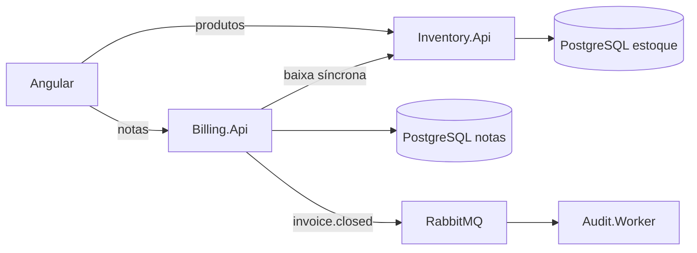

# Inventory Management

Aplicação para cadastrar produtos, controlar saldo de estoque e emitir notas. O estoque e as notas ficam em serviços separados. A baixa de estoque é síncrona; o aviso de nota fechada segue por mensagem.

A nota desta versão registra produto e quantidade. Não há preço, cliente, imposto nem pagamento.

## Funcionalidades

- Cadastrar e listar produtos, com código único, descrição e saldo inicial.
- Criar uma nota aberta com itens copiados do cadastro.
- Emitir a nota: o saldo é baixado e a nota passa de `Open` para `Closed`.
- Recusar baixa quando o produto não existe ou o saldo não cobre a quantidade.
- Ignorar uma segunda baixa da mesma nota, sem alterar o saldo de novo.
- Publicar `InvoiceClosedEvent` na fila `invoice.closed` depois do fechamento.
- Registrar esse evento no log do `Audit.Worker`.
- Consultar produtos e notas, emitir e imprimir a nota fechada no navegador.

Não há tela nem endpoint para editar produto, aumentar estoque ou cancelar nota.

## Arquitetura

| Componente | Papel |
|---|---|
| Frontend Angular | Cadastro, notas e impressão no navegador |
| `Inventory.Api` | Produtos, saldo e baixa |
| `Billing.Api` | Notas, emissão e publicação do evento |
| `Audit.Worker` | Consome `invoice.closed` e escreve no log |
| PostgreSQL | Um banco para o estoque e outro para as notas |
| RabbitMQ | Fila durável `invoice.closed` |
| Docker Compose | Sobe bancos, RabbitMQ, APIs e worker |

O frontend não entra no Compose. `Billing.Api` não acessa o banco do estoque: chama `POST /api/stock/debit`.



Na emissão, a ordem é: Angular chama `Billing.Api`, que chama `Inventory.Api`. Só depois da baixa aceita a nota fica `Closed` e o evento é publicado. Se a baixa falha, a nota continua `Open` e nenhum evento sai.

Mais detalhes de retry, idempotência e erros estão em [docs/TECHNICAL-DETAILS.md](docs/TECHNICAL-DETAILS.md).

## Tecnologias

Versões conferidas nos arquivos do projeto:

- .NET 8 e ASP.NET Core
- Entity Framework Core 8, com `Npgsql.EntityFrameworkCore.PostgreSQL` 8.0.11
- PostgreSQL 16
- `RabbitMQ.Client` 7.2.2 e RabbitMQ 3 com management
- Angular 19.2.25, Angular CLI 19.2.27 e Angular Material 19.2.19
- xUnit 2.5.3, com EF Core InMemory 8.0.11 nos testes
- Docker Compose

## Pré-requisitos

- .NET 8 SDK
- Node.js 20 ou superior, para o Angular
- Docker Desktop, ou outro Docker com Compose
- `dotnet-ef` 8.0.11, a mesma linha do EF Core do projeto: `dotnet tool install --global dotnet-ef --version 8.0.11`

## Portas

| Serviço | Endereço |
|---|---|
| Inventory.Api | http://localhost:5081 |
| Billing.Api | http://localhost:5082 |
| Angular | http://localhost:4200 |
| PostgreSQL do estoque | localhost:5433 |
| PostgreSQL das notas | localhost:5434 |
| RabbitMQ | localhost:5672 |
| RabbitMQ Management | http://localhost:15672 |

## Credenciais locais

Os usuários e senhas do repositório são padrões descartáveis de desenvolvimento, não credenciais de produção:

| Uso | Usuário | Senha |
|---|---|---|
| PostgreSQL do estoque | `inventory` | `inventory` |
| PostgreSQL das notas | `billing` | `billing` |
| RabbitMQ | `guest` | `guest` |

Eles estão em `appsettings.json` e no `docker-compose.yml` para o projeto subir depois do clone. Não use esses valores fora da máquina local.

## Como executar

Os comandos partem da raiz do repositório. As APIs não aplicam migrations na inicialização.

### 1. Bancos e RabbitMQ

```shell
docker compose up -d postgres-inventory postgres-billing rabbitmq
```

### 2. Migrations

Rode no host, com os bancos já aceitando conexão nas portas 5433 e 5434:

```shell
dotnet ef database update --project src/Inventory.Api
dotnet ef database update --project src/Billing.Api
```

O estoque tem `InitialCreate` e `AddProcessedDebit`. As notas têm `InitialCreate`.

### 3. APIs e worker

No Docker, depois das migrations:

```shell
docker compose up -d --build inventory-api billing-api audit-worker
```

Ou no host, em terminais separados:

```shell
dotnet run --project src/Inventory.Api
dotnet run --project src/Billing.Api
dotnet run --project src/Audit.Worker
```

As portas 5081 e 5082 vêm de `launchSettings.json`.

### 4. Frontend

```shell
cd frontend/inventory-management
npm install
npx ng serve
```

Abra http://localhost:4200.

Para ver o log do worker: `docker compose logs -f audit-worker`, ou o console do `dotnet run` do `Audit.Worker`.

## Testes

A suíte automatizada cobre o backend: baixa de estoque, inclusive a repetição da mesma nota, e emissão de notas. Não há testes automatizados do Angular; o projeto não contém arquivos `*.spec.ts`.

```shell
dotnet test InventoryManagement.sln
```

O worker e a interface ficam para verificação manual.

## Decisões e limitações

- A baixa usa o `InvoiceId` como chave única. Repetir a mesma nota não baixa o estoque outra vez.
- O `Billing.Api` tenta a baixa até três vezes, com 200 ms entre elas, só em falha transitória.
- Não há Outbox. Se o RabbitMQ falhar depois do fechamento, a nota permanece `Closed` e o evento pode se perder.
- Duas notas diferentes baixando o mesmo saldo ao mesmo tempo não são tratadas.
- O worker só escreve log. Não guarda trilha de auditoria.
- O número da nota vem da sequence PostgreSQL `invoice_numbers`.

## Roadmap

- Alinhar a linguagem do domínio: hoje a emissão convive com os nomes `Billing` e `Closed`.
- Tornar a publicação do evento confiável, com Outbox.
- Acrescentar testes automatizados do frontend.
- Documentar a API com OpenAPI e tratar erros de forma uniforme.
